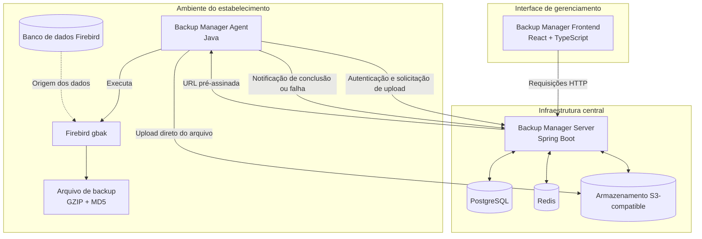

# Backup Manager Ecosystem

Plataforma de gerenciamento e armazenamento de backups desenvolvida para ambientes de supermercados que utilizam bancos de dados **Firebird**.

O Backup Manager Ecosystem reúne três aplicações independentes — Agent, Server e Frontend — que trabalham em conjunto para automatizar a geração de backups, centralizar seu gerenciamento e disponibilizar recursos de acompanhamento e administração por meio de uma interface web.

A solução foi projetada para atender estabelecimentos que possuem seus bancos de dados instalados localmente, permitindo que os arquivos sejam gerados no próprio ambiente do cliente e enviados diretamente para um serviço centralizado de armazenamento.

---

## Visão geral

O ecossistema é dividido em três componentes principais, cada um com responsabilidades bem definidas:

| Componente | Responsabilidade | Tecnologias |
|---|---|---|
| **Backup Manager Agent** | Executar os backups no ambiente do estabelecimento e realizar o envio dos arquivos | Java |
| **Backup Manager Server** | Centralizar as regras de negócio, autenticação, gerenciamento dos estabelecimentos e histórico dos backups | Java, Spring Boot, PostgreSQL, Redis |
| **Backup Manager Frontend** | Disponibilizar a interface web para gerenciamento e acompanhamento | React, TypeScript, Vite |

Cada aplicação possui seu próprio processo de desenvolvimento e build. Entretanto, todas são mantidas neste repositório para facilitar a integração e a evolução do ecossistema.

## Arquitetura

A arquitetura separa as operações executadas no ambiente do estabelecimento das responsabilidades centralizadas no servidor.

O Agent é responsável pelas operações que dependem do acesso local ao banco Firebird. O Server coordena as operações, aplica as regras de negócio e mantém os registros necessários para o gerenciamento dos backups.

O armazenamento dos arquivos é realizado diretamente pelo Agent, utilizando URLs pré-assinadas disponibilizadas pelo Server.

### Diagrama da arquitetura



### Fluxo de execução de um backup

O processo de backup segue as seguintes etapas:

1. O Agent é iniciado no ambiente do estabelecimento e carrega suas configurações locais.
2. O Agent utiliza o utilitário `gbak` para gerar o backup do banco de dados Firebird.
3. O arquivo gerado é compactado utilizando GZIP.
4. É calculado um checksum MD5 para identificação e verificação de integridade do arquivo.
5. O Agent solicita ao Server as informações necessárias para realizar o upload.
6. O Server valida a integração e disponibiliza uma URL pré-assinada para o armazenamento.
7. O Agent realiza o upload diretamente para o serviço de armazenamento, sem precisar encaminhar o conteúdo do arquivo pela API.
8. Após a transferência, o Agent comunica ao Server o resultado da operação.
9. O Server registra o histórico e atualiza o status do backup.

Essa abordagem mantém a API responsável pela coordenação e pelo gerenciamento das operações, enquanto a transferência dos arquivos acontece diretamente entre o Agent e o armazenamento.

---

# Componentes do ecossistema

## 1. Backup Manager Agent

Aplicação desenvolvida em **Java puro**, responsável pela execução dos backups no ambiente dos estabelecimentos.

O Agent funciona próximo ao banco Firebird, possuindo acesso ao banco de dados e aos utilitários necessários para executar o processo de backup.

Sua principal responsabilidade é automatizar o processo de geração, preparação e envio dos arquivos para o armazenamento centralizado.

### Principais responsabilidades

- Carregar as configurações de execução e conexão a partir de um arquivo externo.
- Estabelecer a comunicação com o Backup Manager Server.
- Autenticar-se utilizando a API Key do estabelecimento.
- Executar o utilitário `gbak` por meio de `ProcessBuilder`.
- Gerenciar os arquivos temporários gerados durante a operação.
- Compactar os arquivos de backup utilizando GZIP.
- Calcular o checksum MD5 utilizando processamento em blocos.
- Solicitar URLs pré-assinadas para upload.
- Realizar o upload diretamente para o armazenamento S3-compatible.
- Comunicar ao Server a conclusão ou falha da operação.

### Configuração

O Agent utiliza um arquivo externo chamado `agent.properties`, permitindo configurar individualmente cada ambiente sem necessidade de modificar o código-fonte.

Entre os parâmetros configuráveis estão:

- URL do Backup Manager Server.
- API Key do estabelecimento.
- Host, porta e nome do banco Firebird.
- Credenciais de acesso ao banco de dados.
- Diretório utilizado para armazenar arquivos temporários.

O repositório disponibiliza o arquivo `agent.properties.example` como referência para configuração.

As credenciais reais devem permanecer no ambiente de execução e não devem ser versionadas.

### Tecnologias e recursos utilizados

| Tecnologia | Utilização |
|---|---|
| Java | Desenvolvimento da aplicação |
| Java HttpClient | Comunicação HTTP com o Server e serviços externos |
| ProcessBuilder | Execução do utilitário Firebird `gbak` |
| Jackson | Serialização e desserialização de JSON |
| GZIP | Compactação dos arquivos de backup |
| MD5 | Cálculo de checksum dos arquivos |
| Firebird gbak | Geração dos backups do banco de dados |

---

## 2. Backup Manager Server

API REST desenvolvida utilizando **Java e Spring Boot**, responsável pela lógica central do ecossistema.

O Server concentra as regras de negócio, autenticação, autorização, persistência e integração com o serviço de armazenamento.

É responsável por gerenciar os estabelecimentos, controlar os acessos dos Agents, disponibilizar operações para o dashboard e manter o histórico das execuções de backup.

### Principais responsabilidades

- Gerenciar os estabelecimentos cadastrados.
- Autenticar os Agents por meio de API Keys.
- Autenticar os usuários do dashboard utilizando JWT.
- Gerenciar sessões e refresh tokens utilizando Redis.
- Gerar URLs pré-assinadas para operações de armazenamento.
- Registrar o histórico das operações de backup.
- Gerenciar os status das execuções.
- Disponibilizar informações consolidadas para o dashboard.
- Gerenciar usuários e seus níveis de acesso.
- Controlar o acesso aos dados de cada estabelecimento.

### Autenticação e autorização

O Server possui dois fluxos de autenticação independentes, destinados aos diferentes tipos de clientes da API.

#### Autenticação dos estabelecimentos

Os Agents utilizam autenticação por API Key.

Cada estabelecimento possui sua própria credencial de integração, utilizada para autenticar as requisições originadas em seu ambiente.

A API Key é enviada por meio do cabeçalho HTTP:

```http
X-API-KEY: sua-api-key
```

Esse mecanismo permite identificar o estabelecimento responsável pela requisição e associar as operações ao respectivo cliente.

#### Autenticação dos usuários

Os usuários do dashboard utilizam autenticação baseada em JWT, com access token e refresh token.

O gerenciamento do estado das sessões e dos refresh tokens é realizado utilizando Redis.

Os tokens são utilizados por meio de cookies HttpOnly, reduzindo a exposição das credenciais de autenticação ao JavaScript executado no navegador.

O sistema também contempla revogação de sessões e renovação de tokens.

#### Controle de acesso

O sistema utiliza controle de acesso baseado em papéis (RBAC).

Atualmente, existem dois papéis principais:

| Papel | Responsabilidades |
|---|---|
| `ADMIN` | Gerenciamento administrativo dos usuários e acesso às funcionalidades administrativas |
| `SUPPORT` | Consulta e gerenciamento dos estabelecimentos, acompanhamento dos backups e operações de suporte |

As permissões são controladas pelo Server, garantindo que as operações sejam autorizadas de acordo com o papel do usuário autenticado.

### Gerenciamento de backups

O Server mantém os registros das operações realizadas pelos Agents.

Cada execução possui informações utilizadas para identificar o estabelecimento, acompanhar o resultado da operação e consultar o histórico.

Os backups possuem os seguintes estados:

| Status | Descrição |
|---|---|
| `PENDING` | Operação iniciada e aguardando conclusão |
| `SUCCESS` | Backup concluído com sucesso |
| `FAILED` | Operação de backup finalizada com falha |

Os registros permitem acompanhar o histórico de execução dos estabelecimentos e disponibilizar informações consolidadas para o dashboard.

### Armazenamento de arquivos

A integração com o armazenamento utiliza o protocolo S3-compatible.

O Server é responsável por coordenar as operações de armazenamento, disponibilizando URLs pré-assinadas para que o Agent possa realizar o envio dos arquivos diretamente ao serviço.

Dessa forma:

- O Server controla a autorização e a disponibilização das operações de upload.
- O Agent realiza a transferência do arquivo.
- O armazenamento mantém os arquivos de backup.
- O Server registra o resultado da operação e mantém os metadados necessários para gerenciamento.

Essa separação evita que a API precise receber e retransmitir grandes arquivos de backup.

### Persistência e infraestrutura

O Server utiliza diferentes tecnologias de infraestrutura, cada uma com uma responsabilidade específica:

| Tecnologia | Responsabilidade |
|---|---|
| PostgreSQL | Persistência dos usuários, estabelecimentos e históricos de backup |
| Redis | Gerenciamento do estado dos refresh tokens e sessões |
| S3-compatible storage | Armazenamento dos arquivos de backup |
| Spring Boot | Estrutura da API REST e integração com os componentes de infraestrutura |

A organização da aplicação busca manter as regras de negócio desacopladas dos detalhes de infraestrutura, utilizando interfaces e adaptadores para integração com os recursos externos.

---

## 3. Backup Manager Frontend

Interface web desenvolvida para disponibilizar os recursos de gerenciamento e acompanhamento do ecossistema.

O Frontend consome a API REST do Backup Manager Server.

### Stack utilizada

- React
- TypeScript
- Vite
- Tailwind CSS
- shadcn/ui
- TanStack Query
- React Router
- React Hook Form
- Zod
- Recharts
- Lucide

A aplicação utiliza componentes reutilizáveis, gerenciamento de requisições e validação de formulários para estruturar a interface de gerenciamento.

---

# Tecnologias e infraestrutura

O Backup Manager utiliza tecnologias específicas para cada responsabilidade do ecossistema.

| Tecnologia | Aplicação |
|---|---|
| Java | Desenvolvimento do Agent e Server |
| Spring Boot | Construção da API REST |
| PostgreSQL | Banco de dados relacional |
| Redis | Gerenciamento de sessões e refresh tokens |
| S3-compatible storage | Armazenamento de arquivos |
| React | Desenvolvimento da interface web |
| TypeScript | Tipagem estática no Frontend |
| Docker | Containerização dos serviços |
| Docker Compose | Orquestração do ambiente integrado |
| Nginx | Servidor web e proxy reverso do Frontend |
| Maven | Gerenciamento de dependências e build dos projetos Java |

## Ambiente Docker

O ambiente integrado utiliza Docker Compose para inicializar os serviços necessários à execução do Server e do Frontend.

Os serviços são organizados da seguinte maneira:

| Serviço | Função |
|---|---|
| PostgreSQL | Persistência relacional |
| Redis | Estado de autenticação e sessões |
| Silo | Serviço de armazenamento compatível com S3 |
| Backup Manager Server | API REST |
| Backup Manager Frontend | Interface web e proxy reverso |

O Agent é executado separadamente do Docker Compose, pois precisa acessar os recursos disponíveis no ambiente local do estabelecimento, especialmente o banco Firebird e o utilitário `gbak`.

---

# Estrutura do repositório

O monorepo mantém as três aplicações em diretórios independentes, com seus próprios arquivos de configuração, dependências e processos de build.

```text
backupmanager-ecosystem/
│
├── backupmanager-agent/
│   ├── src/
│   ├── .mvn/
│   ├── pom.xml
│   ├── mvnw
│   └── agent.properties.example
│
├── backupmanager-server/
│   ├── src/
│   ├── .mvn/
│   ├── pom.xml
│   ├── mvnw
│   └── Dockerfile
│
├── backupmanager-frontend/
│   ├── src/
│   ├── package.json
│   ├── package-lock.json
│   ├── Dockerfile
│   └── nginx.conf
│
├── .github/
│   └── workflows/
│
├── compose.yaml
├── .env.example
├── .gitignore
└── README.md
```

A organização permite que cada aplicação evolua de maneira independente, enquanto o repositório principal concentra a documentação, a infraestrutura e os recursos compartilhados do ecossistema.

---

# Executando o ambiente

## Pré-requisitos

Para executar o ambiente integrado, são necessários:

- Git
- Docker
- Docker Compose

Para desenvolvimento individual das aplicações:

- JDK compatível com os projetos Java.
- Maven Wrapper, incluído nos projetos Java.
- Node.js e npm para o Frontend.

## 1. Clonando o repositório

```bash
git clone URL_DO_REPOSITORIO
```

Entre no diretório:

```bash
cd backupmanager-ecosystem
```

## 2. Configurando as variáveis de ambiente

O repositório disponibiliza um arquivo `.env.example` com as variáveis necessárias para configurar o ambiente.

Crie seu arquivo `.env`:

```bash
cp .env.example .env
```

Edite o arquivo e configure os valores de acordo com seu ambiente.

Entre as configurações disponíveis estão:

| Variável | Finalidade |
|---|---|
| `POSTGRES_DB` | Nome do banco PostgreSQL |
| `POSTGRES_USER` | Usuário do PostgreSQL |
| `POSTGRES_PASSWORD` | Senha do PostgreSQL |
| `STORAGE_S3_BUCKET_NAME` | Nome do bucket de armazenamento |
| `STORAGE_S3_REGION` | Região configurada para o armazenamento |
| `STORAGE_S3_ACCESS_KEY` | Credencial de acesso ao armazenamento |
| `STORAGE_S3_SECRET_KEY` | Chave secreta do armazenamento |
| `JWT_SECRET` | Segredo utilizado para assinatura dos tokens JWT |
| `API_SECURITY_TOKEN_ACCESS_EXPIRATION` | Tempo de expiração do access token |
| `API_SECURITY_TOKEN_REFRESH_EXPIRATION` | Tempo de expiração do refresh token |

Utilize credenciais próprias para cada ambiente e mantenha o arquivo `.env` fora do controle de versão.

## 3. Inicializando os serviços

Na raiz do monorepo, execute:

```bash
docker compose up --build -d
```

O Docker Compose irá construir as imagens necessárias e iniciar os serviços definidos no `compose.yaml`.

Para acompanhar os logs:

```bash
docker compose logs -f
```

Para consultar o estado dos containers:

```bash
docker compose ps
```

## 4. Acessando os serviços

Com as portas padrão definidas na configuração do Compose:

| Serviço | Endereço |
|---|---|
| Frontend | http://localhost:5173 |
| Backup Manager Server | http://localhost:8080 |
| Console do armazenamento | http://localhost:9001 |
| Endpoint do armazenamento | http://localhost:9000 |

O acesso ao console do armazenamento utiliza as credenciais configuradas no arquivo `.env`.

O bucket configurado para o Backup Manager deve existir no serviço de armazenamento. Caso não tenha sido criado automaticamente, ele pode ser criado pelo console administrativo.

### Comunicação entre Frontend e Server

No ambiente Docker, o Frontend utiliza o Nginx como proxy reverso para encaminhar as requisições destinadas à API ao serviço `server`.

A URL base utilizada pelo Frontend durante o build da imagem é:

```text
/api/v1
```

Isso permite que o navegador acesse a API pela mesma origem do Frontend, enquanto o Nginx realiza a comunicação interna com o Server pela rede do Docker Compose.

## 5. Encerrando o ambiente

Para parar os containers:

```bash
docker compose down
```

Esse comando mantém os volumes persistentes.

Para remover também os volumes e os dados armazenados:

```bash
docker compose down --volumes
```

**Atenção:** o segundo comando remove os volumes do ambiente, incluindo os dados persistidos do PostgreSQL, Redis e armazenamento.

---

# Executando as aplicações individualmente

Os projetos também podem ser compilados e executados de maneira independente, respeitando suas dependências e configurações.

## Backup Manager Agent

Entre no diretório:

```bash
cd backupmanager-agent
```

Compile a aplicação utilizando o Maven Wrapper:

```bash
./mvnw clean package
```

Antes da execução, configure o arquivo `agent.properties` com os dados do ambiente, incluindo:

- Endereço do Backup Manager Server.
- API Key do estabelecimento.
- Configurações de conexão com o Firebird.
- Diretório temporário utilizado durante o processo.

O ambiente de execução também precisa possuir o utilitário `gbak` disponível.

## Backup Manager Server

Entre no diretório:

```bash
cd backupmanager-server
```

Compile a aplicação:

```bash
./mvnw clean package
```

Para execução local, configure as propriedades necessárias para conexão com PostgreSQL, Redis e armazenamento S3-compatible.

## Backup Manager Frontend

Entre no diretório:

```bash
cd backupmanager-frontend
```

Instale as dependências:

```bash
npm install
```

Configure a variável `VITE_API_BASE_URL` conforme o endereço da API utilizada no ambiente local.

O arquivo `.env.example` do Frontend contém a referência de configuração para desenvolvimento local.

Inicie o servidor de desenvolvimento:

```bash
npm run dev
```

---

# Segurança e configuração

O ecossistema utiliza mecanismos distintos de autenticação e controle de acesso, considerando as necessidades dos Agents e dos usuários administrativos.

Algumas recomendações importantes para configuração e execução:

- Não versionar arquivos `.env` que contenham credenciais reais.
- Não versionar o arquivo `agent.properties` utilizado nos estabelecimentos.
- Utilizar o `agent.properties.example` como modelo de configuração.
- Configurar um segredo JWT forte e exclusivo para cada ambiente.
- Utilizar credenciais próprias para PostgreSQL, Redis e armazenamento.
- Restringir o acesso às portas dos serviços de infraestrutura conforme o ambiente de implantação.
- Proteger as API Keys utilizadas pelos estabelecimentos.
- Não compartilhar credenciais de autenticação ou armazenamento.

---

# Decisões arquiteturais

O Backup Manager foi estruturado a partir da separação de responsabilidades entre os componentes que fazem parte do ecossistema.

### Separação entre Agent e Server

O Agent executa as operações que dependem do ambiente local do estabelecimento, enquanto o Server concentra as regras de negócio e os recursos centralizados.

Essa divisão permite que o processo de backup aconteça próximo à origem dos dados, sem exigir que o Server tenha acesso direto aos bancos Firebird dos estabelecimentos.

### Upload direto para o armazenamento

A transferência dos arquivos acontece diretamente entre o Agent e o serviço de armazenamento, utilizando URLs pré-assinadas fornecidas pelo Server.

O Server permanece responsável pela coordenação da operação e pelo registro de seu resultado, sem precisar atuar como intermediário na transferência do conteúdo dos arquivos.

### Separação entre metadados e arquivos

O PostgreSQL mantém os registros e metadados necessários para o gerenciamento das operações, enquanto os arquivos de backup são armazenados em um serviço compatível com S3.

Essa abordagem separa a persistência relacional do armazenamento de objetos.

### Autenticação independente por tipo de cliente

O sistema utiliza API Keys para autenticação dos Agents e JWT para autenticação dos usuários do dashboard.

Essa separação permite aplicar mecanismos de autenticação e autorização adequados aos diferentes contextos de acesso.

### Organização em aplicações independentes

Cada componente possui seu próprio ambiente de desenvolvimento, dependências e processo de build.

O monorepo centraliza o código-fonte e os recursos compartilhados, facilitando a manutenção e a integração entre as aplicações.

---

# Considerações finais

O Backup Manager Ecosystem reúne os componentes necessários para automatizar o processo de backup de bancos de dados Firebird em ambientes de supermercados.

A solução combina execução local, gerenciamento centralizado, autenticação, persistência de metadados e armazenamento de objetos, mantendo responsabilidades bem definidas entre suas aplicações.

O resultado é uma arquitetura modular, preparada para atender múltiplos estabelecimentos e centralizar o acompanhamento das operações de backup em uma única plataforma.
